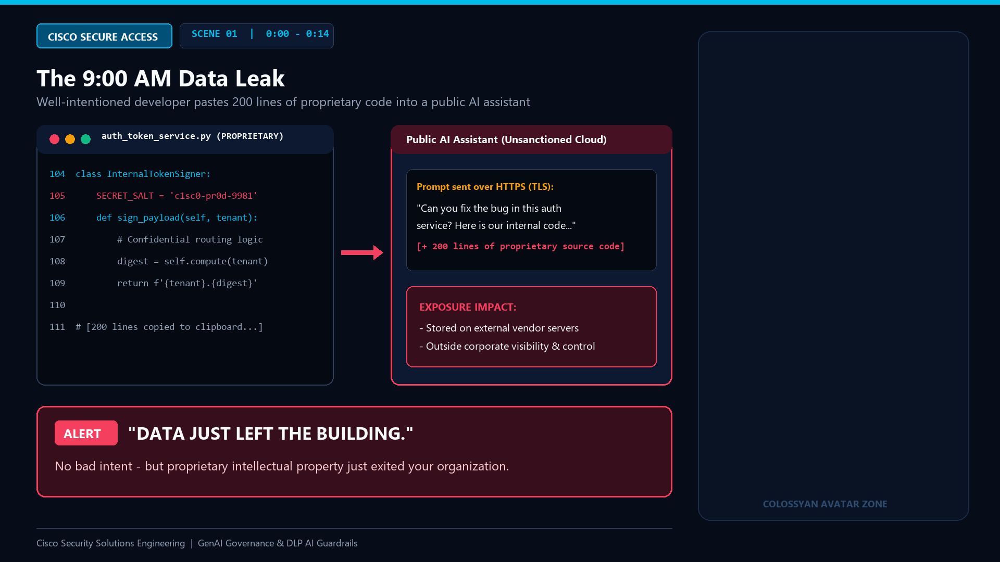
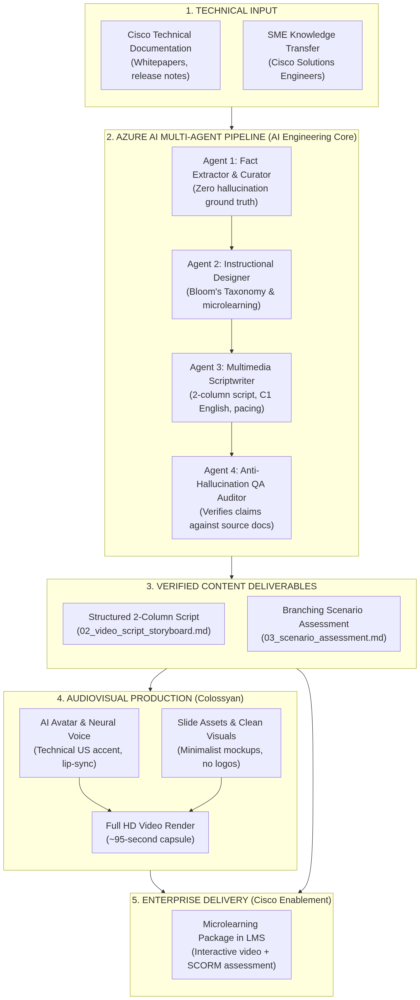
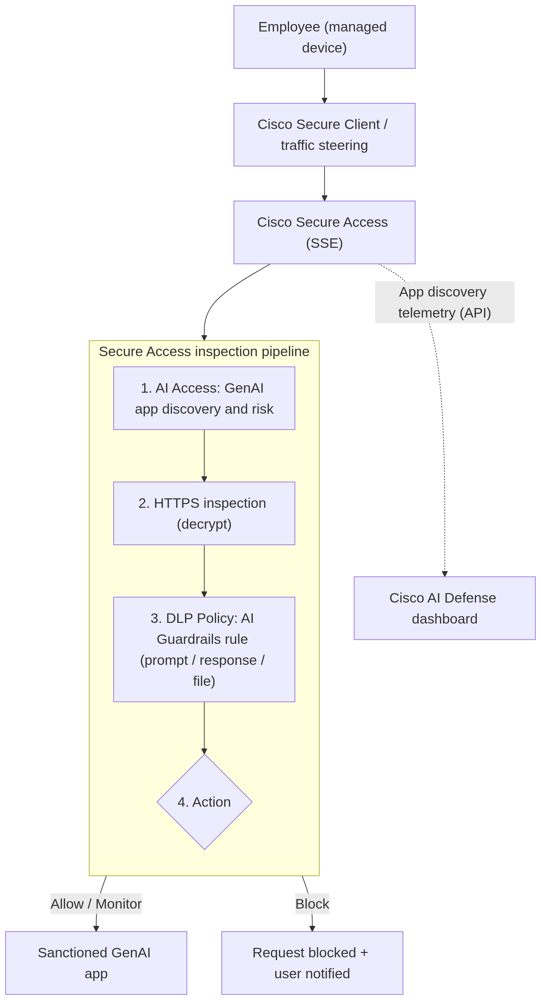
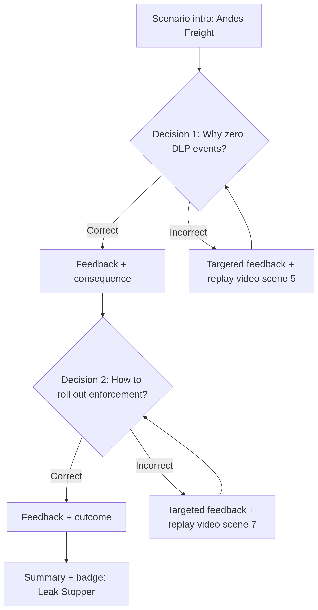

# Cisco Security Technical Enablement: AI-Assisted Microlearning Suite

> **Proof of Work (PoW) Portfolio Project**  
> **Target Role:** Sr. AI Content Developer (Cisco Security Solutions Engineering)  
> **Author:** Fernando Pedernera — *AI Engineer & Machine Learning Specialist*  
> **Disclaimer:** *Concept sample developed exclusively for technical evaluation purposes. © 2026. All rights reserved. Not for commercial distribution or production use.*

---

## 1. Executive Summary & Final Video Deliverable

This repository demonstrates an **end-to-end AI-powered instructional development pipeline** designed to create and modernize advanced technical learning experiences for Cisco Security Solutions Engineering.

Instead of manual, slow content drafting, this project leverages a **multi-agent GenAI architecture on Microsoft Azure (Azure AI Foundry — `gpt-5-mini`)** that ingests raw engineering documentation and produces validated, zero-hallucination microlearning packages:
* **Pedagogical Framing:** Bloom’s Revised Taxonomy (*Analyze, Apply, Evaluate*).
* **Audiovisual Production:** 2-column technical video scripts + `1080p` visual canvases produced in **Colossyan Studio**.
* **Interactive Assessment:** Branching enterprise scenarios (*Andes Freight* case) with corrective remediation.
* **Anti-Hallucination QA & FinOps:** Strict automated fact-checking against official Cisco documentation with token-optimized reasoning controls (`reasoning=low` + disk cache guard).

### 🎬 Final Product: AI-Generated Microlearning Video (Colossyan Studio)

* **▶️ Watch the Full Microlearning Video on YouTube:** **[Cisco Secure Access: Governing Shadow AI with DLP AI Guardrails (Colossyan AI Demo)](https://www.youtube.com/watch?v=p4PykHBDhSA)**

[](https://www.youtube.com/watch?v=p4PykHBDhSA)

---

## 2. End-to-End Workflow Architecture

[](diagrams/04_end_to_end_architecture_diagram1.png)

```text
[ Raw Cisco Technical Docs ] 
             │
             ▼
[ Azure AI Multi-Agent Pipeline ] ──► Agent 1: Extractor ──► Agent 2: Instructional Design ──► Agent 3: Scriptwriter ──► Agent 4: QA Auditor
             │
             ▼
[ Content Package ] ───────────────► 2-Column Script + 1080p Slide Deck + Branching Assessment
             │
             ▼
[ Colossyan Studio ] ─────────────► Synthetic AI Avatar (1080p, 150 wpm, Lip-sync, EN/ES Subtitles)
             │
             ▼
[ LMS & Web Suite Delivery ] ─────► Interactive FastAPI Suite (port 8020) + Production Video
```

---

## 3. Instructional Design & Technical Architecture (M1)

**Module Title:** *Stop the Leak: Governing Workforce GenAI with Cisco Secure Access*  
**Target Audience:** Security Solutions Engineers, Network Security Engineers, and Cloud Security Administrators.

[](diagrams/01_instructional_design_diagram1.png)

### Learning Objectives (Bloom's Revised Taxonomy)
* **LO1 — Analyze (*Bloom: Analyze*):** Given an AI Access discovery report from **Cisco Secure Access**, differentiate between sanctioned and unsanctioned GenAI usage (*Shadow AI*) and identify the data-exfiltration risk profile of each application.
* **LO2 — Apply (*Bloom: Apply*):** Configure an inline **Data Loss Prevention (DLP)** policy using an **AI Guardrails** rule—together with the required **HTTPS Inspection** prerequisite on the matching Access Policy—to inspect prompts, responses, and file uploads for sensitive data and source code.
* **LO3 — Evaluate (*Bloom: Evaluate*):** Given a live enterprise incident involving developers pasting proprietary source code into a public LLM, select the policy enforcement sequence (**`Monitor` $\rightarrow$ baseline $\rightarrow$ tune false positives $\rightarrow$ `Block`**) that prevents data leakage without disrupting legitimate workflows.

---

## 4. 2-Column Video Script & Colossyan Studio Kit (M2)

All 8 `1920x1080` slide visuals, the combined PDF deck (`cisco_colossyan_8_scenes_deck.pdf`), and synchronized English/Spanish `.srt` & `.vtt` subtitle tracks are located in [`app/static/colossyan_slides/`](app/static/colossyan_slides/).

| Scene & Timecode | Visual Canvas (`1920x1080`) | Avatar Voiceover Narration (`US - Rachel`, ~150 wpm) |
| :--- | :--- | :--- |
| **1 — Hook**<br>`0:00–0:14` | IDE (`auth_token_service.py`) pasted into public AI chat; red alert banner: *"DATA JUST LEFT THE BUILDING."* | It's nine a.m. `[pause]` A developer pastes two hundred lines of proprietary code into a public AI assistant to fix a bug. `[pause]` No bad intent. `[beat]` But that code just **left your organization**. |
| **2 — Problem**<br>`0:14–0:32` | 3 failure cards: 1. Blanket Category Blocking, 2. Legacy Pattern-Only DLP, 3. Uninspected TLS/HTTPS Traffic. | This is **Shadow AI**: employees using GenAI apps that IT never approved. `[pause]` And traditional controls fall short. `[pause]` Blocking the category pushes users to personal devices. `[pause]` Pattern-only DLP misses context. `[pause]` And without decryption, you can't even **see** the prompt. |
| **3 — Framework**<br>`0:32–0:38` | 5-step pipeline diagram: `Discover → Decrypt → Classify → Enforce → Refine`. | Cisco Secure Access turns GenAI governance into five steps: `[pause]` discover, decrypt, classify, enforce, and refine. |
| **4 — Discover**<br>`0:38–0:50` | **AI Access Dashboard** mockup showing risk scores (`CRITICAL`, `HIGH`, `LOW`) and governance status. | First, **discover**. `[pause]` AI Access shows which GenAI apps are in use across your organization, and how risky they are. `[beat]` You can't govern what you can't see. |
| **5 — Decrypt**<br>`0:50–1:02` | Comparison diagram: `HTTPS Inspection OFF (0 Hits)` vs. `HTTPS Inspection ON (Prompt Inspected)`. | Second, **decrypt**. `[pause]` Prompt inspection requires HTTPS inspection on the matching access policy. `[pause]` Skip this step, and every prompt is just encrypted traffic. `[beat]` It's a common misconfiguration. |
| **6 — Classify & Enforce**<br>`1:02–1:17` | **DLP Policy > AI Guardrails** rule builder inspecting Prompts, Responses, and File Uploads (`Monitor` / `Block`). | Next, **classify and enforce**. `[pause]` In your DLP policy, add an **AI Guardrails** rule. `[pause]` It inspects prompts, responses, and file uploads for sensitive data and source code, `[pause]` then monitors or blocks the interaction. |
| **7 — Refine**<br>`1:17–1:25` | 3-phase rollout timeline: `Phase 1: Monitor Mode` $\rightarrow$ `Phase 2: Tune False Positives` $\rightarrow$ `Phase 3: Enforce Block`. | Finally, **refine**. `[pause]` Start in Monitor mode. `[pause]` Baseline real usage, tune out false positives, then move to Block. |
| **8 — Close**<br>`1:25–1:36` | Executive takeaway checklist & transition to the *Andes Freight* interactive scenario challenge. | Shadow AI is a **data-exposure** problem. `[beat]` The answer isn't to block AI. `[pause]` It's to **govern** it. `[beat]` Now, let's put that into practice. |

---

## 5. Branching Scenario Assessment (M3 — *Andes Freight* Case)

[](diagrams/03_scenario_assessment_diagram1.png)

* **Decision 1 (The Silent Rule — Tests LO2):** Maya configures a DLP `AI Guardrails` rule for Engineering, yet it logs **0 hits** despite active GenAI traffic in `AI Access`. Learners must diagnose the missing **HTTPS Inspection** prerequisite on the matching Access Policy.
* **Decision 2 (The CISO's Ultimatum — Tests LO1 & LO3):** Faced with executive pressure to block all AI categories before a major software release, learners must evaluate operational trade-offs and execute a phased **`Monitor` $\rightarrow$ baseline $\rightarrow$ tune false positives $\rightarrow$ `Block`** rollout.

---

## 6. Repository Structure & Deliverables Matrix

| Component | Path | Description |
| :--- | :--- | :--- |
| **Final Video Demo** | **[▶️ YouTube (`1080p HD`)](https://www.youtube.com/watch?v=p4PykHBDhSA)** | Complete 8-scene AI Avatar Microlearning Video rendered in **Colossyan Studio**. |
| **Interactive Web Suite** | [`app/main.py`](app/main.py) | FastAPI + Dark Glassmorphism Web Suite (`port 8020`) with live Azure execution, source doc loader, local bilingual video previewer, and branching simulator. |
| **Azure 4-Agent Pipeline** | [`tools/pipeline_azure_ai.py`](tools/pipeline_azure_ai.py) | Executable 4-agent chain (`Extractor` $\rightarrow$ `Instructional Designer` $\rightarrow$ `Scriptwriter` $\rightarrow$ `QA Auditor`) on Azure AI Foundry (`gpt-5-mini`). |
| **Colossyan Slide Generator** | [`tools/generate_colossyan_slides.py`](tools/generate_colossyan_slides.py) | Python generator that renders the 8 `1920x1080` slide canvases and combined PDF deck. |
| **Colossyan Assets & SRTs** | [`app/static/colossyan_slides/`](app/static/colossyan_slides/) | 8 `1920x1080` PNG slides, `cisco_colossyan_8_scenes_deck.pdf`, and synchronized EN/ES `.srt` & `.vtt` subtitles. |
| **Cisco Technical Sources** | [`source_docs/`](source_docs/) | Technical source documentation for *Cisco Secure Access (SSE)* and *Cisco Catalyst SD-WAN* ingested by Agent 1. |

---

## 7. Alignment with Target Role Competencies

| Target Role Competency | How This Project Proves It |
| :--- | :--- |
| **Hands-on GenAI / LLM content development** | Full microlearning courseware generated, structured, and validated via GenAI workflows. |
| **Claude or comparable LLM platforms** | Multi-agent prompt pipeline engineered on **Azure AI Foundry / Azure OpenAI (`gpt-5-mini`)** with zero-shot guardrails. |
| **AI Agents or connected AI workflows** | 4-stage sequential agent chain (`tools/pipeline_azure_ai.py` + FastAPI web dashboard) with real-time token & FinOps telemetry. |
| **AI-generated video & Colossyan experience** | Final video produced in **Colossyan Studio** with 2-column script, audio pacing tags, and custom `1080p` canvases. |
| **Modern instructional & learning design** | Rigorous application of Bloom's Taxonomy, microlearning pacing, and interactive branching scenario assessments. |
| **Cybersecurity / SASE / SSE / SD-WAN context** | Grounded in **Cisco Secure Access**, AI Access, HTTPS inspection, DLP AI Guardrails, and Catalyst SD-WAN. |
| **Content QA & Technical Accuracy** | Automated Agent 4 QA fact-checking table ensuring 100% verifiable technical claims against source documentation. |

---

## 8. Quickstart: Launching the Interactive Web Suite & Agent Pipeline

### Prerequisites
* Python 3.10+
* Azure AI Foundry / Azure OpenAI deployment (configured in `.env` from `.env.example`)

### Option A: Launch Interactive FastAPI Web App (Recommended)

```bash
# 1. Configure your Azure credentials
cp .env.example .env

# 2. Launch the web suite on http://localhost:8020
./start_app.bat
# Or directly with Uvicorn:
python -m uvicorn app.main:app --host 127.0.0.1 --port 8020 --reload
```

### Option B: Run CLI Pipeline Directly

```bash
# Run live against Cisco Secure Access documentation
python tools/pipeline_azure_ai.py --doc source_docs/cisco_secure_access_source.md

# Run offline architecture simulation (no API keys required)
python tools/pipeline_azure_ai.py --offline
```

---

## 9. Author Contact & Portfolio

* **Engineer:** Fernando Pedernera
* **Focus:** AI Engineering | RAG Architectures | MLOps | Technical Content Enablement
* **Location:** Córdoba, Argentina
* **Email:** fernando.peder.ia@gmail.com
* **Project Repository:** [github.com/fernando-pedernera/proyecto_cisco_segurity](https://github.com/fernando-pedernera/proyecto_cisco_segurity)
* **Final Video Demo (YouTube):** [youtube.com/watch?v=p4PykHBDhSA](https://www.youtube.com/watch?v=p4PykHBDhSA)
